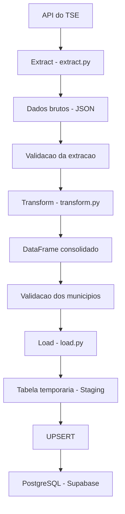
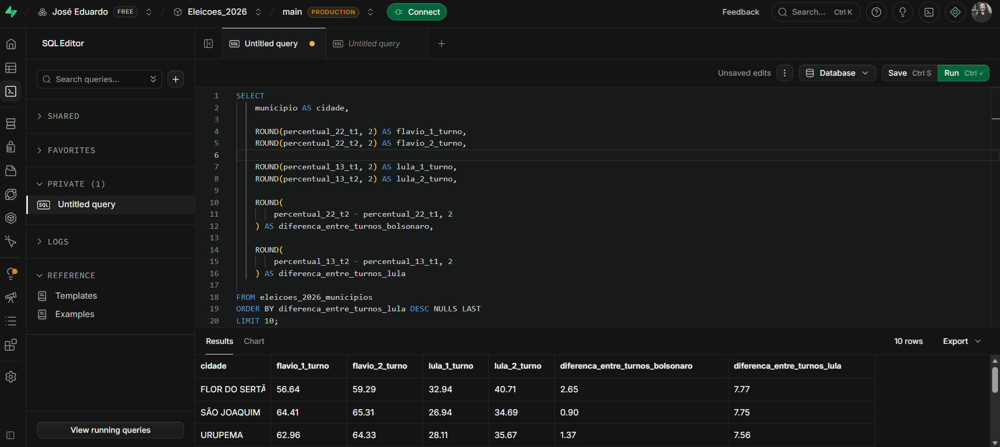

# Pesquisa Eleitoral 2026


<p align="center">
    
</p>

## Sobre o projeto

Projeto pessoal de Engenharia de Dados desenvolvido para extrair, transformar, validar e armazenar resultados da eleição presidencial brasileira de 2026, utilizando dados da API do Tribunal Superior Eleitoral (TSE).

O pipeline permite selecionar uma Unidade Federativa (UF), consultar os resultados municipais dos dois turnos e consolidar as informações em uma base relacional no PostgreSQL, hospedado no Supabase.

O recorte de candidatos contempla os números 13 e 22. Os indicadores de totalização abrangem o conjunto da votação, não apenas esses candidatos.

## Objetivos

- Consumir dados de uma API REST.
- Desenvolver um pipeline ETL modular em Python.
- Persistir dados brutos em arquivos JSON para reutilização.
- Aplicar técnicas de transformação e qualidade de dados com pandas.
- Integrar Python a um banco de dados PostgreSQL em nuvem.
- Garantir a unicidade dos registros por meio de chaves primárias e UPSERT.
- Disponibilizar uma base estruturada para futuras análises eleitorais e dashboards.

## Arquitetura do pipeline



O arquivo `main.py` coordena todas as etapas do pipeline.

### Extract

Consulta a lista de municípios da UF selecionada e os resultados eleitorais dos dois turnos. Utiliza requisições HTTP com timeout e política de novas tentativas (retry). Os dados brutos são armazenados localmente em JSON.

### Transform

Converte os resultados em um DataFrame, padroniza os tipos de dados, valida as informações e consolida os dois turnos em uma única linha por município.

### Load

Cria uma tabela temporária com a estrutura da tabela de destino, insere os registros utilizando SQLAlchemy e executa um UPSERT no PostgreSQL. A carga ocorre em uma única transação, com rollback em caso de falha e remoção automática da tabela temporária ao confirmar a transação.

## Tecnologias utilizadas

| Tecnologia | Finalidade |
| --- | --- |
| Python 3.12 | Desenvolvimento do pipeline |
| Requests | Consumo da API REST |
| urllib3 | Política de retry |
| pandas | Manipulação e transformação de dados |
| SQLAlchemy | Conexão e execução de comandos SQL |
| psycopg2-binary | Driver PostgreSQL |
| python-dotenv | Gerenciamento de variáveis de ambiente |
| PostgreSQL | Armazenamento relacional |
| Supabase | Hospedagem do banco de dados |
| Git e GitHub | Versionamento e publicação do projeto |
| VS Code e WSL | Ambiente de desenvolvimento |

## Estrutura do projeto

```text
Pesquisa Eleitoral/
├── data/                   # JSONs gerados durante a execução
├── testes/                 # Scripts de teste
├── .env                    # Credenciais locais (não versionado)
├── .env.example            # Modelo de configuração
├── .gitignore              # Regras de exclusão do Git
├── config.py               # Configurações do projeto
├── database.py             # Conexão com PostgreSQL
├── extract.py              # Extração dos dados
├── transform.py            # Transformação e validação
├── load.py                 # Carregamento dos dados
├── main.py                 # Orquestração do ETL
├── requirements.txt        # Dependências Python
└── README.md               # Documentação
```

## Modelo de dados

Tabela de destino: `public.eleicoes_2026_municipios`.

- **Granularidade:** uma linha por município, contendo os dois turnos.
- **Chave primária composta:** `uf` + `codigo_tse`.
- **Quantidade de colunas:** 24.

| Grupo | Campos |
| --- | --- |
| Identificação (4) | `uf`, `codigo_tse`, `codigo_ibge`, `municipio` |
| Totalização (12) | `eleitorado_apto`, `comparecimento`, `abstencoes`, `votos_validos`, `votos_brancos`, `votos_nulos`, cada um com sufixos `_t1` e `_t2` |
| Candidatos (8) | `votos_13_t1`, `percentual_13_t1`, `votos_13_t2`, `percentual_13_t2`, `votos_22_t1`, `percentual_22_t1`, `votos_22_t2`, `percentual_22_t2` |

## Qualidade e confiabilidade dos dados

- Verificação das combinações esperadas de município e turno.
- Validação da quantidade de municípios e dos códigos TSE.
- Identificação de registros duplicados.
- Verificação dos percentuais eleitorais.
- Validação da presença das colunas obrigatórias e da ausência de nulos na chave primária.
- Conferência da relação entre eleitorado, comparecimento e abstenções.
- Carregamento transacional e atualização de registros existentes via UPSERT.
- Registro de eventos e erros com a biblioteca `logging`.

## Como executar

### 1. Pré-requisitos

- Python 3.12.
- Acesso à internet para consultar a API do TSE.
- Banco PostgreSQL no Supabase e credenciais válidas.

### 2. Ambiente virtual

Na raiz do projeto, utilizando Linux ou WSL:

```bash
python3 -m venv .venv
source .venv/bin/activate
python -m pip install -r requirements.txt
```

### 3. Variáveis de ambiente

```bash
cp .env.example .env
```

Preencha o arquivo `.env` com as credenciais do seu banco:

```env
DB_HOST=
DB_PORT=5432
DB_NAME=postgres
DB_USER=
DB_PASSWORD=
```

Nunca publique o arquivo `.env` ou credenciais reais no repositório.

### 4. Preparação do banco de dados

Execute o SQL abaixo no SQL Editor do Supabase para criar a tabela de destino, caso ainda não exista:

```sql
CREATE TABLE IF NOT EXISTS public.eleicoes_2026_municipios (
    uf TEXT NOT NULL,
    codigo_tse TEXT NOT NULL,
    codigo_ibge TEXT,
    municipio TEXT,
    eleitorado_apto_t1 INTEGER,
    comparecimento_t1 INTEGER,
    abstencoes_t1 INTEGER,
    votos_validos_t1 INTEGER,
    votos_brancos_t1 INTEGER,
    votos_nulos_t1 INTEGER,
    eleitorado_apto_t2 INTEGER,
    comparecimento_t2 INTEGER,
    abstencoes_t2 INTEGER,
    votos_validos_t2 INTEGER,
    votos_brancos_t2 INTEGER,
    votos_nulos_t2 INTEGER,
    votos_13_t1 INTEGER,
    percentual_13_t1 NUMERIC(7,4),
    votos_13_t2 INTEGER,
    percentual_13_t2 NUMERIC(7,4),
    votos_22_t1 INTEGER,
    percentual_22_t1 NUMERIC(7,4),
    votos_22_t2 INTEGER,
    percentual_22_t2 NUMERIC(7,4),
    PRIMARY KEY (uf, codigo_tse)
);

ALTER TABLE public.eleicoes_2026_municipios
ENABLE ROW LEVEL SECURITY;
```

<p align="center">
    
</p>

Utilize uma conexão PostgreSQL autorizada a inserir e atualizar os registros. Não desabilite a segurança do banco para executar o pipeline.

### 5. Teste da conexão

```bash
python3 database.py
```

### 6. Execução do pipeline

```bash
python3 main.py
```

Informe a UF desejada, por exemplo:

```text
Informe a UF: SC
```

O pipeline reutiliza o arquivo JSON local quando disponível. Para consultar novamente os resultados municipais na API, remova ou renomeie o JSON correspondente à UF antes de executar.

## Resultados da execução

O pipeline foi executado com sucesso para Santa Catarina:

| Indicador | Resultado |
| --- | ---: |
| Municípios | 295 |
| Turnos | 2 |
| Combinações município/turno | 590 |
| Registros consolidados | 295 |
| Colunas | 24 |

Consulta para conferir a quantidade de registros no banco:

```sql
SELECT uf, COUNT(*) AS total_municipios
FROM public.eleicoes_2026_municipios
GROUP BY uf;
```

## Competências desenvolvidas

- Engenharia de Dados e desenvolvimento de pipelines ETL.
- Integração com APIs REST e tratamento de falhas HTTP.
- Manipulação, transformação e validação de dados com Python e pandas.
- Modelagem relacional, SQL e chaves primárias compostas.
- Transações, tabelas temporárias e UPSERT no PostgreSQL.
- Integração com banco de dados em nuvem.
- Modularização de código, logging e gerenciamento de dependências.
- Segurança de credenciais e preparação para versionamento.

## Fonte dos dados

- [Tribunal Superior Eleitoral (TSE)](https://www.tse.jus.br/)
- [Portal de Resultados Eleitorais](https://resultados.tse.jus.br/)

Projeto independente, desenvolvido para fins educacionais e de portfólio, sem vínculo institucional com o TSE e sem finalidade de promoção político-partidária.
